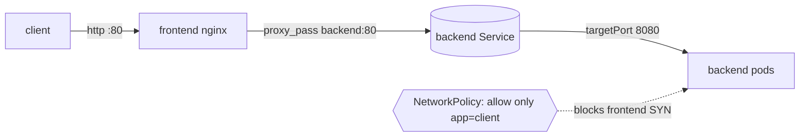

# k8s-network-troubleshooting
# Kubernetes Network Troubleshooting: frontend → backend failure

A reproduction and root-cause analysis of a NetworkPolicy that silently blocks
`frontend → backend` traffic, investigated with `kubectl` and Cilium Hubble.

**Video walkthrough:** <PASTE_VIDEO_LINK_HERE>

## Summary

| | |
|---|---|
| **Symptom** | frontend cannot reach backend (timeout, nginx returns 504) |
| **Root cause** | NetworkPolicy allowed ingress to backend only from `app=client`, not `app=frontend` |
| **Fix** | Added `app=frontend` as an allowed source in the policy (kept least privilege) |
| **Key signal** | Timeout (not "connection refused") + Hubble `Policy denied DROPPED` |

## Environment

- WSL2 (Ubuntu), Docker
- Kind v0.27.0: 1 control-plane + 2 worker nodes (default CNI disabled)
- CNI: Cilium 1.17.6 (eBPF) with Hubble (Relay + UI)
- Workloads (namespace `demo`):
  - `client`: curlimages/curl pod
  - `frontend`: nginx, proxies to the backend Service
  - `backend`: hashicorp/http-echo listening on 8080 (Service port 80 → targetPort 8080), 2 replicas



## Repository layout

```
kind-config.yaml                      Kind cluster config (default CNI disabled for Cilium)
manifests/                            namespace, backend, frontend, client (numbered apply order)
scenarios/01-networkpolicy-block/
    break.yaml                        the injected bug
    fix.yaml                          the fix
scripts/
    setup.sh                          cluster + Cilium + apps + baseline check
    break.sh                          inject the bug
    diagnose.sh                       run the investigation checks
    fix.sh                            apply the fix
    verify.sh                         verify + negative test
    collect-evidence.sh               regenerate all outputs in docs/evidence/
docs/evidence/                        raw command outputs
```

## How to reproduce

Prerequisites: Docker, kubectl, kind, helm, cilium CLI.

```bash
./scripts/setup.sh      # cluster + Cilium + apps, prints baseline
./scripts/break.sh      # inject the bug
./scripts/diagnose.sh   # run the investigation
./scripts/fix.sh        # apply the fix
./scripts/verify.sh     # verify + negative test
```

`manifests/` is numbered (`00-namespace.yaml` first) because applying a
folder in alphabetical order otherwise tries to create Deployments before the
namespace exists.

## Baseline (working state)

```
client   → frontend → backend   : "hello from backend"
frontend → backend              : "hello from backend"
```

Evidence: [`docs/evidence/01-baseline.txt`](docs/evidence/01-baseline.txt)

## 1. Symptom

Ticket: *"frontend cannot reach backend."*

| Test | Result |
|---|---|
| `client → frontend` | **HTTP 504** after ~60 s (nginx gave up waiting for backend) |
| `frontend → backend` | **timeout**, curl exit code 28 |

With a short client timeout (`-m 8`) the first test shows `000` instead of 504,
because curl gives up before nginx does.

## 2. Investigation

Method: **Observe → Investigate → Identify → Fix → Verify**, ruling out one
layer at a time.

| # | Question | Command | Result |
|---|---|---|---|
| 1 | Are pods healthy? | `kubectl -n demo get pods -o wide` | All Running, no restarts |
| 2 | Is the Service correct? | `kubectl -n demo describe svc backend` | port 80 → targetPort 8080, selector `app=backend` |
| 3 | Does the Service have endpoints? | `kubectl -n demo get endpoints backend` | Populated with backend pod IPs |
| 4 | Does DNS resolve? | `kubectl -n demo exec deploy/client -- nslookup backend.demo.svc.cluster.local` | Resolves |
| 5 | Does the pod IP work (bypass Service)? | `kubectl -n demo exec deploy/frontend -- curl -m 5 http://<podIP>:8080` | **Timeout** from frontend |
| 6 | Same target from another source? | `kubectl -n demo exec deploy/client -- curl -m 5 http://<podIP>:8080` | **Works** from client |
| 7 | Any NetworkPolicy? | `kubectl -n demo describe networkpolicy backend-allow-only-client` | Ingress allowed only from `app=client` |
| 8 | What happens at packet level? | `hubble observe --namespace demo --verdict DROPPED` | frontend SYN dropped |

All commands are collected in `scripts/diagnose.sh`.
Evidence: [`docs/evidence/02-troubleshooting.txt`](docs/evidence/02-troubleshooting.txt)

## 3. Observations

- The failure is a **timeout, not "connection refused"**. Refused would mean a
  closed port or a dead application; a timeout means packets are silently
  dropped, which points to a policy or firewall.
- Pods, Service, Endpoints and DNS were all healthy, so this is not a
  selector, targetPort, or DNS problem.
- Calling the pod IP directly also failed from the frontend, so the problem
  is not in the Service / kube-proxy layer.
- **The same backend is reachable from `client` but not from `frontend`.**
  Destination is identical, only the source differs, so the filtering is
  source-based: a NetworkPolicy.
- Hubble confirms it:

  ```
  demo/frontend-...:41328 <> demo/backend-...:8080  policy-verdict:none INGRESS DENIED (TCP Flags: SYN)
  demo/frontend-...:41328 <> demo/backend-...:8080  Policy denied DROPPED (TCP Flags: SYN)
  ```

  - `INGRESS DENIED` / `policy-verdict:none`: the backend's ingress policy
    matched no allow rule for the frontend.
  - Only `SYN` is seen: the TCP handshake never completes, which explains the
    timeout. The repeated SYNs about one second apart are TCP retransmits.
- Tooling note: the latest `hubble` CLI against Hubble Relay 1.17.6 returned
  `invalid fieldmask` (client/server version mismatch). Workaround: run
  `hubble observe` inside the `cilium-agent` pod, whose version matches.
  Each agent only sees flows of its own node, so I looped over all agents.

Evidence: [`docs/evidence/02b-hubble-dropped.txt`](docs/evidence/02b-hubble-dropped.txt)

## 4. Root cause

NetworkPolicy `backend-allow-only-client` selects the backend pods and allows
ingress only from pods labelled `app=client`. Once a pod is selected by an
ingress policy, all ingress not explicitly allowed is denied. `app=frontend`
had no allow rule, so its packets were dropped at the backend.

```yaml
ingress:
  - from:
      - podSelector:
          matchLabels:
            app: client      # frontend missing
```

## 5. Resolution

Added `app=frontend` to the `from` list instead of deleting the policy, so the
backend stays protected from everything else (`scenarios/01-networkpolicy-block/fix.yaml`):

```bash
kubectl apply -f scenarios/01-networkpolicy-block/fix.yaml
```

## 6. Verification

| Test | Result |
|---|---|
| `frontend → backend` | `hello from backend` |
| `client → frontend` (through to backend) | `hello from backend` |
| `client → backend` | `hello from backend` |
| Negative test: a random `intruder` pod → backend | **Blocked** (timeout) |

The negative test shows the fix did not weaken security: only `client` and
`frontend` can reach the backend.

Evidence: [`docs/evidence/03-after-fix.txt`](docs/evidence/03-after-fix.txt)

## 7. Prevention

- Review NetworkPolicies against the full service dependency graph before
  applying them ("who calls this service?").
- Name policies after what they allow (this one should be
  `backend-allow-frontend-and-client`).
- Test policy changes in staging and watch Hubble for `Policy denied` drops.
- Export Hubble drop metrics and alert on unexpected spikes.
- Run a connectivity smoke test (`scripts/verify.sh`) in CI after every
  policy change.

## Other scenarios worth testing

Service selector mismatch (empty endpoints), wrong `targetPort`, wrong DNS
name. These produce different signals: empty endpoints, connection refused, or
NXDOMAIN, which helps tell them apart from a policy drop.
